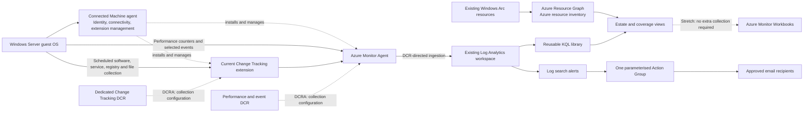

# Architecture: Azure Arc Configuration Manager replacement PoC

**Phase 2 design for approval, 5 November 2026. No build or deployment authorised.**

## 1. Reviewed scope and decisions

The owner reviewed [discovery findings](discovery-findings.md) and confirmed:

- The three Windows Arc machines are deliberately powered off. They can be
  started when needed; their disconnected status is not currently a fault.
- Focus on the owner-nominated existing Arc Log Analytics workspace. Exclude
  MCAPS and default workspaces from PoC selection, without deleting or changing
  them. Resource names and IDs remain in private evidence and future parameters.
- Existing security roles or collections may be removed to avoid PoC confusion.
  Translate this into an exact, dependency-checked cleanup list before deployment,
  not a blanket deletion of RBAC, Defender settings or shared collection.
- Introduce no deprecated agents, features or toolsets.
- Target **US$200/month for the PoC**, with approval required before a forecast
  exceeds that amount. USD is the planning assumption, not a confirmed billing
  currency. See the cost scope and exclusions below.

The preferred workspace was checked again using a read-only resource GET. It is
the current destination for both monitored servers, uses pay-as-you-go pricing
and 30-day retention, and has the ChangeTracking solution. Its region is listed
as supported by the current CTI support matrix [3]. Public ingestion/query
access is enabled; no workspace daily cap is configured. Do not silently change
these shared settings.

**Decision:** reuse this workspace, subject to ownership, access and data-handling
checks; create no workspace for the approved baseline. Initially validate one
named test server, then extend to the three discovered Windows servers.

## 2. Logical architecture and data flow

Arc is the control plane, not a proxy through which all telemetry passes. The
Connected Machine agent manages identity and extensions; AMA collects and sends
guest data using DCR configuration. A DCR is configuration, not a separate
store-and-forward appliance. DCR associations bind rules to the machines.
CTI collects scheduled configuration evidence and sends it through AMA to the
workspace [1, 2, 4].

Resource Graph covers Azure resources and extension/association configuration,
not SCCM-style guest hardware inventory. Log Analytics covers guest evidence.
Combine the two in presentation, keeping source and freshness visible.

## 3. Capability mapping

| Configuration Manager capability | Azure replacement | Services | Gaps / limitations |
| --- | --- | --- | --- |
| Central server estate view | Arc resource inventory and connectivity | Arc, Resource Graph | RBAC-filtered, eventually consistent; not full hardware discovery |
| Agent deployment / monitoring configuration | Extensions and scoped collection configuration | Arc, AMA, DCRs, Bicep; later Policy | Existing onboarding remains; no application or OS deployment |
| CPU, memory and disk monitoring | Selected guest performance counters | AMA, Log Analytics, KQL | Sampling and ingestion delay; physical RAM utilisation needs a reliable total |
| Windows event monitoring | Filtered System/Application collection | AMA, event DCR, Log Analytics | Not a SIEM; Security collection optional and off by default |
| Installed software inventory | Last inventory plus subsequent changes | AMA-based CTI, Log Analytics | Scheduled and subject to item limits; no software metering or licence reconciliation |
| Software install/removal detection | Configuration-change history | AMA-based CTI | Not immediate; short-lived changes between scans can be missed |
| Service state and startup-type tracking | Service inventory and change records | AMA-based CTI | All services collected, subject to limits; alert filtering happens in queries |
| Registry / file change tracking | Explicitly selected items | AMA-based CTI | HKLM-only registry coverage; file and item limits; not arbitrary endpoint forensics |
| Operational alerting | Threshold and change-based rules | Azure Monitor, Action Group | Threshold tuning and expected-offline handling required |
| Reports and dashboards | Saved query library; optional Workbooks | Resource Graph, Log Analytics, Workbooks | Workbooks are stretch scope, not required for core acceptance |
| Patching, app deployment, OS deployment, Machine Configuration | Separate future projects | See [limitations](limitations.md) | Explicitly excluded from this PoC |

## 4. Lifecycle-safe monitoring choice

**Use a custom Windows performance DCR writing to `Perf`, plus filtered events
writing to `Event`. Do not add a VM Insights DCR alongside it.**

- AMA is the supported guest agent and has no separate agent-use charge [1].
  Reuse suitable installed extensions; validate their health after power-on.
- Do not install MMA/OMS, legacy Automation-based Change Tracking, Dependency
  Agent, Service Map or VM Insights Map. Microsoft explicitly marks VM Insights
  Map and Dependency Agent deprecated, retiring on **30 June 2028** [5].
- Do not treat the word "classic" as a retirement announcement for every
  logs-based feature. Current Learn still documents custom performance DCRs,
  `Perf` and event collection for Arc [6, 7]. No retirement is announced for
  these selected collection paths in the sources checked on this date.
- Microsoft now recommends OpenTelemetry metrics for new monitoring deployments;
  that supported path also works with Arc but uses an **Azure Monitor workspace
  and PromQL**, not this PoC's Log Analytics/KQL performance library [8].
  Do not auto-onboard through a portal workflow that creates another workspace
  or enables per-process metrics, Grafana or extra paid features.
- VM Insights `InsightsMetrics` collection is not selected: it adds a second
  performance data model without a core requirement. Its schema is documented
  [9], but no `InsightsMetrics`-dependent queries or resources are required here.

This is a deliberate KQL/cost/scope decision, not a claim that OpenTelemetry is
deprecated or unsupported. Recheck lifecycle notices before Build and deployment.
If the selected path is newly marked for retirement, stop and revise the design.

## 5. Collection baseline

### Performance and Windows events

Use one Windows-only performance/event rule, with one workspace destination [6,
7]. Proposed defaults are parameters, not customer-specific constants:

| Signal | Proposed collection | Interval / interpretation |
| --- | --- | --- |
| CPU | Total processor utilisation | 60 seconds; choose one validated Windows CPU counter |
| Available memory | Available MBytes | 60 seconds |
| Memory commit | Committed-bytes percentage of commit limit | 60 seconds; label as **commit utilisation**, not physical RAM utilisation |
| Physical memory utilisation | Derive from available memory and a verified per-server physical-memory total, if supplied | Never infer total RAM from Resource Graph; otherwise omit this percentage |
| Logical disk capacity | Free MB and percentage free, for approved fixed data/OS volumes | 60 seconds; exclude `_Total` and irrelevant instances |
| Logical disk activity | Idle percentage, read/write operations per second and average transfer latency | 60 seconds; derive utilisation from idle percentage, not percentage free |
| System events | `System!*[System[(Level=1 or Level=2 or Level=3)]]` | Event-driven delivery after collection; not a 60-second event sampling promise |
| Application events | `Application!*[System[(Level=1 or Level=2 or Level=3)]]` | Critical, Error and Warning |
| Security events | Disabled in the PoC rule | Separate explicit opt-in, permission/privacy review and cost estimate |

Validate counter paths, units, available instances and localisation on the named
test server before enabling them across the estate. Do not copy the existing
disk selector unchecked. Do not introduce redundant Windows/Linux counter
spellings; Learn warns this can cause duplicate collection [6].

The existing Security selector is separate from the proposed baseline. An
off-by-default PoC parameter does **not** disable existing collection. Its removal
must be in the approved cleanup/cutover manifest.

### Current AMA-based Change Tracking and Inventory

Enable the supported Windows extension
`Microsoft.Azure.ChangeTrackingAndInventory / ChangeTracking-Windows`,
alongside `Microsoft.Azure.Monitor / AzureMonitorWindowsAgent` [2, 10].
Current CTI guidance requires extension **2.20.0.0 or later** [2]; older minimum
versions in historical service examples are not the deployment recommendation.
Pick a currently supported, region-available release during Build. AMA support
is limited to versions released within the last year; enable approved automatic
extension upgrades and do not downgrade a suitable existing version [11].

Use a **dedicated CTI DCR** and exactly one CTI association per machine. Reuse an
existing suitable rule. If adding PoC paths or collection settings would modify
other workloads, prepare a separate PoC rule and switch only the approved target
associations during deployment; do not attach a second CTI rule or modify a
shared rule in place. Keep performance/events out of the CTI DCR [4].

| Change type | Proposed setting | Documented collection cadence / scope |
| --- | --- | --- |
| Windows software | Inventory and change tracking enabled | 30 minutes; retain name, version and publisher; identify added/removed software |
| Windows services | Enabled, with 10-minute collection requested | Supported range 10-30 minutes; default 30 minutes; verify requested setting takes effect |
| Registry | A short approved list plus a synthetic PoC key under HKLM | 50 minutes; no promise of a supported faster setting |
| Files | A short approved list plus a synthetic PoC file | 30-40 minutes; use the supported minimum only after validating the settings |

These are collection periods, not end-to-end SLAs. Allow ingestion, query and
alert evaluation delay afterwards. Keep a test change present until a collection
cycle observes it; service stop/start within one cycle might not be recorded.
Run a baseline collection before demonstrating removals or state changes.

Parameterise the PoC registry key, file path and designated test service. Use
only synthetic, non-secret content. File-content upload/storage is not enabled
in the baseline; checksum/metadata changes are sufficient for the demonstration.

Important CTI constraints from the current support matrix [3]:

- All services are collected; a selected-service collection allowlist is not
  supported. Filter the important-service list in KQL/alerts instead.
- Published Windows limits: 250 software items excluding updates, 250 services,
  250 registry items and 500 files; tracked files must be no larger than 5 MB.
  Confirm that important services/software are represented before claiming
  complete coverage. Do not promise SCCM inventory parity.
- Registry collection is limited to HKLM. Do not track secrets or broad paths.
- CTI DCR transformations are not supported. Do not attempt to save cost by
  dropping CTI records in a transformation.

## 6. Query and presentation contracts

The Build phase will create one documented query file per requested scenario.
All guest queries scope by the supplied Arc resource IDs, normalised for casing.
Do not silently expand queries to the whole shared workspace.

| Source | Verified fields used in the design | Expected output |
| --- | --- | --- |
| Resource Graph `Resources` | Arc resource identity, OS/status properties, extension and association resources | One row per server, Azure inventory and coverage; distinct from guest inventory |
| `Perf` [12] | `_ResourceId`, `TimeGenerated`, `ObjectName`, `CounterName`, `InstanceName`, `CounterValue` | Timestamped CPU/memory/disk series with units and volume identity |
| `Event` [13] | `_ResourceId`, `TimeGenerated`, `EventLog`, `EventLevel`, `EventID`, `Source`, `RenderedDescription` | Critical/error events; warnings retained for investigation |
| `ConfigurationData` [14] | `ConfigDataType`, `SoftwareName`, `CurrentVersion`, `Publisher`, `SvcName`, `SvcState`, `SvcStartupType` | Last reported inventory, with observation time and staleness |
| `ConfigurationChange` [15] | `ConfigChangeType`, `ChangeCategory`, `SoftwareName`, `RegistryKey`, `FileSystemPath`, `SvcName`, `SvcState`, `SvcPreviousState`, `SvcStartupType`, `SvcPreviousStartupType` | Recent installs/removals, file/registry changes and service state/startup-type changes |
| `Heartbeat` [16] | `_ResourceId`, `TimeGenerated` | Last AMA heartbeat per expected-online server, including never-reporting servers |

`ConfigurationData` is not refreshed for every change between inventory scans
[3]. Current software/service views must reconcile a baseline with later
changes, including software removal, instead of treating the last inventory
snapshot as live state. Prefer the most recent observation per item and mark
old/unknown observations rather than showing a stale service as healthy.

Heartbeat queries must start from the configured expected-server list and
left-join observed heartbeats. Starting only from `Heartbeat` misses machines
that never reported. An absent heartbeat is a monitoring symptom, not proof
that the Arc agent or a particular service is at fault.

Use normalised query output columns and shared time/server parameters for later
Workbooks. Tests must cover removals after inventory, stopped-then-started
services, never-reporting servers, intentional shutdowns and stale evidence.

## 7. Alert baseline

Use at most **eight workspace-scoped log search rules** and one parameterised
Action Group, reusing equivalent existing configuration where suitable. Default
notifications are email; SMS, voice, paid webhooks and external automation are
not enabled. No recipients or customer IDs belong in source control.

Current monitoring documentation distinguishes recommended Azure VM host-metric
alerts from guest/log alerts [17]. New enhanced monitoring can also supply
recommended alerts with its metrics-based experience [8]. Do not claim that all
recommended alerts are unavailable to Arc. Instead, verify each candidate's
resource type and data source during Build; use a documented supported rule
only if it matches this collection path and is not equivalent to an existing
rule. This custom `Perf`/`Event` design otherwise uses log search alerts.

| Rule | Initial condition | Evaluation / lookback | Rationale and noise controls |
| --- | --- | --- | --- |
| High CPU | Mean total CPU >90% with sufficient samples | 5 / 15 minutes | Sustained load, not a single spike |
| Low memory | Available memory <500 MB with sufficient samples | 5 / 15 minutes | Tune per server; do not mistake commit ratio for RAM use |
| Low disk capacity | Any approved fixed volume <10% free **and** <5 GB free | 5 / 15 minutes | Avoid alarms for ample space on large disks; retain worst-volume details |
| Critical Windows events | At least one approved critical event | 5 / 10 minutes | Source/event-ID filters and one stateful incident; errors remain queryable |
| Important service stopped | Most recent fresh observation of an expected-running service is stopped | 5 / 60 minutes | Reconcile later start/state changes; CTI cadence dominates latency |
| Unexpected software | Added software outside the approved PoC baseline/allowlist | 15 / 60 minutes | Allow the designated test application; controlled test override |
| Monitored configuration change | Change to approved registry/file items outside the baseline | 15 / 120 minutes | One combined rule, with item/type in investigation results |
| Missing heartbeat | No heartbeat for >15 minutes, or never received after onboarding grace | 5 / 60 minutes | Expected-online list, maintenance exclusion and stale-data labelling |

Thresholds, allowlists, sample sufficiency and evaluation settings are parameters.
Resolve stateful alerts after recovery; changes do not constitute permanent
current state. Split by server only where necessary and costed, with at most
three server series per rule initially; avoid uncontrolled item/volume dimensions.

The machines are intentionally offline now. Keep availability notifications
disabled until a powered-on baseline passes; later exclude planned shutdowns
through an explicit maintenance/expected-online configuration. Do not enable a
monitoring rule that repeatedly alerts about the agreed lab shutdown schedule.
Resource Graph continues to provide Arc status separately.

## 8. Resources, Bicep boundaries and scale

The proposed Build layout uses `infra/main.bicep` and separate modules under
`infra/modules/`. These are planned paths, not files built in this phase.

| Module boundary | Ownership and dependencies |
| --- | --- |
| Workspace | Existing reference by parameterised resource ID. Conditional creation module remains disabled for this design. |
| AMA extension | One per target Arc machine; discover and reuse a suitable existing extension, regardless of its resource name. |
| Performance/event DCR | Reuse if equivalent, otherwise a uniquely named PoC rule; Windows kind and one existing workspace destination. |
| CTI DCR and extension | Dedicated CTI rule and supported Windows extension; do not duplicate either. |
| DCR associations | At each parameterised Arc machine scope; reuse equivalent associations. |
| Action Group | Reuse one suitable group or create one PoC group; destinations explicitly supplied. |
| Alert rules | Workspace-scoped, deduplicated against retained definitions and query intent. |
| Workbooks | Optional `Microsoft.Insights/workbooks` instances with JSON under `workbooks/`; disabled by default [18]. |

Bicep orchestrates the correct subscription/resource-group scopes for the
workspace, monitoring rules and existing Arc machines; do not assume one
resource group contains them all. Pass region, IDs, extension choices, data
settings, expected-online servers, important services, alert settings,
notification destinations and tags as parameters. Keep customer parameter
values outside tracked example files.

During Build, verify each resource type/API version against its current Learn
template reference and provider availability before pinning it. No deployment
API versions are guessed or copied from old samples in this design.

For ongoing compliance after the PoC, design a narrowly scoped Policy assignment
for supported AMA/CTI deployment and association with the selected DCR IDs [2,
19]. Prefer suitable current built-ins; review initiative members so deprecated
Dependency Agent onboarding or out-of-scope services are not introduced. Audit
first; deploy-if-not-exists remediation, managed identity grants and policy
enforcement require separate approval. Bicep remains the controlled PoC
deployment mechanism; do not run two remediation owners over the same resources.

## 9. Prerequisites, RBAC and data handling

- Power on one named test server for live pre-deployment checks and later
  validation. No power-on is needed to review this design or build local files.
  The owner controls the host; an Arc machine resource is not its VM host.
- Confirm supported OS, Connected Machine agent, managed identity, local extension
  permissions, DNS, outbound TLS/proxy access and AMA endpoints. The discovered
  Windows Server versions are in AMA's current supported OS list [20].
- Verify existing extension versions against current supported releases and
  region rollout. A successful old provisioning state is not sufficient.
- Review workspace ownership, network policy and data residency. This design
  does not add Private Link, a Data Collection Endpoint or networking resources;
  if required by the environment, revise and cost that design before deployment.
- Readers need scoped Azure Reader/Monitoring Reader and appropriate Log
  Analytics query access. Deployment needs extension write permission on the
  target machines and DCR/association/alert/Action Group permissions at their
  scopes. Use approved scoped roles such as Azure Connected Machine Resource
  Administrator and Monitoring Contributor, or a narrower custom role.
- Workspace modifications, if approved, need their own workspace write
  permissions; `existing` Bicep references do not justify workspace Contributor.
  Role-assignment changes need a separately authorised RBAC administrator.
  Do not grant Owner for routine deployment or remove the deployment identity's
  access during cleanup. See monitoring RBAC guidance [21].
- Store only synthetic PoC file/registry data. Software names, service accounts,
  paths and event messages can expose operational or personal information.
  Limit query access, retain only the agreed period and do not export raw guest
  records or notification addresses into Git.

## 10. Cost and licensing

### Budget model and evidence

The target is **US$200/month for attributable PoC running costs**, not an
authorisation to spend US$200 immediately. The model assumes three servers,
a 30-day month, one existing pay-as-you-go workspace, Analytics-plan tables,
eight alert rules and no new Defender, Sentinel, Grafana, storage or compute
services.

On 5 November 2026, the public Retail Prices API returned **US$2.99/GB** for
paid Analytics Logs ingestion in the candidate workspace's region and
**US$0.13/GB/month** for additional retention. The ingestion response also has
a zero-price tier; this estimate deliberately credits **no free allowance**
because it might already be consumed. Rates were read without sending customer
identifiers. The API is documented in [22]; Learn requires region/offer-specific
estimation and actual-volume checks [23, 24]. These are retail estimates,
not contractual quotes.

| Cost component | Planning allowance / assumption |
| --- | --- |
| Arc resource inventory and control plane | No additional inventory charge [25] |
| AMA itself | No agent-use charge; ingestion/storage separate [1] |
| CTI service charge without verified benefits | Published US$6/server/month [25]; reserve **US$7/server/month**, US$21 total, pending offer/hourly reconciliation |
| Ingestion, baseline | 0.10 GB/server/day x 3 x 30 x US$2.99 = **US$26.91/month** |
| Ingestion, stress case | 0.40 GB/server/day x 3 x 30 x US$2.99 = **US$107.64/month** |
| Additional retention | **US$0 assumed** while retaining current 30-day Analytics retention; no extended retention/archive/search jobs [24] |
| All alert evaluations, bounded server series and notifications | **US$40/month reserve**, not a verified exact quote for eight rules |
| Contingency | **US$20/month**, not a substitute for accounting for existing costs |
| Model total | **US$107.91 baseline; US$188.64 stress case** |

The alert API returned a US$3/month one-minute system-log meter and separate
per-resource frequency meters, but not a clearly identifiable complete
five-minute base price in this query. Do not treat a per-resource meter as the
full rule price. Confirm base rules, dimensions and notification pricing with
the signed-in calculator before deployment; reduce the rule set or seek approval
if the US$40 reserve is insufficient. Log alert pricing varies with evaluation
frequency and time-series splitting [26].

Ingestion is a sizing assumption, **not an observed measurement**. For illustration,
three non-disk counters plus six counters on each of two volumes is 15 series:
21,600 records/day at 60 seconds. At an assumed 600 billable bytes/record that is
about 13 MB/day/server for performance. Filtered events and scheduled CTI account
for the remaining allowance and can vary substantially. CTI service filtering
and transformations cannot be used to enforce the estimate [3].

The totals do **not** prove the full lab is below US$200. Existing SQL assessment
ingestion, existing security/Defender/Sentinel charges, other use of this shared
workspace, host/cloud VM compute, operating-system licensing, network charges,
taxes and exchange rates are not yet costed. Include all such costs attributable
to the PoC before approval; unrelated subscription costs remain outside this
estimate. For a 31-day month the ingestion line increases proportionally.
Do not power up paid cloud hosts or enable a paid plan merely to fit this model.

### Benefits and licensing: do not assume entitlement

| Scenario | Implication |
| --- | --- |
| Windows Server with active Software Assurance or eligible subscription licences, with required attestation | Windows Server Management enabled by Arc includes CTI service access; ingestion/storage/network costs remain [27]. Do not attest without owner confirmation. |
| Windows Server pay-as-you-go enabled by Arc | Includes CTI management benefits, but adds OS licensing charges. Current documentation applies to Windows Server 2025, not the discovered 2016/2022 estate [28]. Do not enrol or replace licences for this PoC. |
| Defender for Servers Plan 2 | Some Arc management capabilities are bundled [25]. Do not assume a standalone CTI exemption solely from a broad bundling statement; verify the exact offer and enrollment. Do not enable Essential Machine Management preview or a Defender plan just to obtain a benefit. |
| Defender ingestion benefit | The 500 MB/node/day benefit is conditional and restricted to eligible security data. It is **not** a blanket waiver for `Perf`, ordinary System/Application `Event` data or CTI [29]. No discount is credited in the budget. |
| Defender Plan 1 / unknown licensing | No assumed CTI or ingestion benefit; use the conservative paid-service allowance. |

The Arc price page lists both US$6/month and US$0.009/hour for the combined
guest-configuration/CTI line without explaining their reconciliation [25].
The US$7 reserve avoids promising a mathematically inconsistent exact bill.
Confirm the applied billing meter/terms before deployment. No Machine
Configuration resources are introduced merely because the pricing line is
combined.

### Spend controls and stop conditions

1. Keep one workspace destination, no duplicate counters and Security collection
   off in the PoC baseline. No per-process, broad file content or broad event
   collection; no commitment tier at this scale.
2. Measure attributable billable ingestion for at least 24-48 hours on the
   first powered-on test server before extending to all three. Inspect billed
   bytes, event sources, CTI inventory size and existing shared-workspace usage.
3. Use a proposed US$200 Cost Management budget with actual/forecast notifications
   at 50%, 75% and 90%, scoped to the agreed costs. Creating it requires deployment
   approval. Budgets **do not stop consumption** and cost data is delayed [30].
4. Review when attributable ingestion exceeds 0.30 GB/server/day or the forecast
   exceeds US$150/month. Stop expansion at a US$180 forecast and get owner approval
   for any proposed US$200+ run rate. Account for existing costs before comparing.
5. Consider a workspace daily cap only after proving the workspace is isolated
   or obtaining owner approval for shared impact. It is currently unlimited.
   A cap can overshoot, causes monitoring gaps and is not a hard spending limit
   or normal filtering mechanism [31]. Do not silently apply one.
6. If more is needed, present the revised volumes, fixed charges and reason for
   the increase, plus lower-cost options, **before** enabling it. This design
   does not request a higher budget.

## 11. Deployment, cleanup and rollback plan

**Both Build and deployment remain gated.** After Design approval, implement and
locally validate Bicep, PowerShell and query fixtures. Run Bicep build/lint,
PSScriptAnalyzer and target-scope what-if in the approved Build/pre-deployment
process. Review all create/modify/delete operations before explicit deployment
approval. No what-if or deployment ran during Design.

Before any cleanup:

1. Refresh discovery and export exact existing rule, association, alert, group
   and relevant RBAC configuration to the ignored private evidence directory.
2. Produce an itemised manifest: exact ID, owner, other consumers, proposed
   detach/delete/update, justification, replacement and rollback. Validate that
   policies will not immediately recreate the old collection.
3. Prefer detaching an obsolete collection from the selected PoC machines over
   deleting a shared DCR. Preserve SQL assessment and excluded workspaces unless
   explicitly included in the targeted approved cleanup.
4. Interpret permission to remove security roles/collections as permission for
   a scoped cleanup proposal. Never purge subscription/management-group roles,
   access needed by other workloads, or Defender/Sentinel configuration as a
   side effect. No RBAC changes are necessary for the baseline collection itself.

After explicit approval, deploy incrementally:

| Step | Action | Gate before continuing |
| --- | --- | --- |
| 1 | Verify existing workspace, permissions, current prices and attributable costs | Reuse confirmed; no new workspace; budget assumptions accepted |
| 2 | Owner starts the named test server; check Arc and existing AMA, install/upgrade AMA only if required | Connected and healthy; expected online |
| 3 | Prepare/reuse performance/event DCR, perform approved old-association cutover, associate new rule | No concurrent equivalent collection; heartbeat, performance and events arrive |
| 4 | Prepare/reuse dedicated CTI rule, perform approved single-rule cutover, install/reuse CTI extension | Baseline software/services and monitored items observed after scheduled collection |
| 5 | Reuse/create one Action Group and deduplicated alert rules | Approved receiver test succeeds; controlled alert/recovery scenarios pass |
| 6 | Observe first-server ingestion/cost for 24-48 hours, then extend to remaining powered-on targets | Forecast within budget; no unexplained duplicate ingestion |
| 7 | Workbooks only if separately approved as stretch | Core validated; no extra collection enabled |

Rollback in reverse order: disable only newly introduced alerts; revert PoC
guest changes; remove PoC workbook instances; detach PoC associations and restore
the recorded previous ones; restore any explicitly modified existing settings;
delete only confirmed unreferenced PoC-owned DCRs/groups. Remove newly installed
extensions only when they were absent before the PoC and have no other consumers.
Do not downgrade reused agents, delete Arc resources, erase workspace data or
delete the reused workspace. Preserve audit evidence securely and remove only
PoC-specific access grants with a verified access-retention plan.

Restoring collection does not restore missed telemetry or erased data. Data
already ingested remains subject to retention and charges.

## 12. Validation, demonstration and stretch

Live validation requires the owner to power on the agreed server(s). Record Arc
connectivity, AMA health, exact associations, heartbeat/performance/events, CTI
baseline and changes, query results, alert firing/recovery and measured costs
in the later validation documentation. Do not report "no data" as success or
validate only one query and assume the rest work.

The reversible demonstration will target one explicitly named test server,
with a dedicated test service and synthetic application/key/file/event.
Never stop a production service. Hold changes through their documented
collection windows and prepare evidence in advance; registry/software/file
changes will not appear immediately. Any short CPU load is optional and bounded.

**Stretch:** four Workbooks for estate, health, software/configuration changes
and operational monitoring. Use the same parameterised query contracts,
server/time filters and explicit stale/offline states. Deploy workbook instances
with Bicep and versioned JSON [18]; do not enable new telemetry or Dependency
Agent for presentation. Core acceptance must not depend on Workbooks.

## 13. Documentation discrepancies and approval gate

- Some table-reference descriptions still say "Log Analytics agent" or omit Arc
  from resource-type lists. Current AMA event and CTI onboarding documents
  explicitly support Arc [2, 7, 10]; use their collection guidance and the table
  references for column names, then verify actual target records during validation.
- The CTI table references advertise workspace transformation support, whereas
  the CTI support matrix prohibits CTI DCR transformations [3, 14, 15]. Follow
  the stricter CTI guidance and apply no transformation without clarification.
- The support matrix repeats item limits and disagrees on Linux daemon limits.
  This Windows-only design uses the consistent Windows limits; do not infer
  additional supported capacity from a conflicting row.
- Extension release notes can precede regional availability [11]. Resolve
  availability and supported version at Build rather than pinning a guessed
  "latest" version here.
- Pricing and licensing ambiguity is handled conservatively above; confirm exact
  meters/entitlements instead of claiming free monitoring or a guaranteed bill.

**Requested next approval:** accept the reuse-first, custom AMA/KQL architecture,
the scoped cleanup process and the provisional cost envelope, then authorise
Build. A separate exact change/cleanup plan and explicit approval are still
required before any deployment or deletion. The test-server identity,
notification destinations, runtime schedule and licence entitlements can remain
private parameters; deployment cannot proceed without them.

## Sources

Checked on 5 November 2026. Microsoft Learn MCP is unavailable in this session;
Learn pages were fetched directly. No claim is made that the MCP server was used.
The [MCP installation guide](https://github.com/MicrosoftDocs/mcp/blob/main/README.md)
describes enabling it for later phases.

1. [AMA overview, architecture and agent cost](https://learn.microsoft.com/en-us/azure/azure-monitor/agents/azure-monitor-agent-overview)
2. [Current AMA-based CTI overview](https://learn.microsoft.com/en-us/azure/azure-change-tracking-inventory/overview-monitoring-agent)
3. [CTI support matrix, frequencies, limits and regions](https://learn.microsoft.com/en-us/azure/azure-change-tracking-inventory/change-tracking-inventory-support-matrix)
4. [Dedicated CTI DCR and single-rule constraint](https://learn.microsoft.com/en-us/azure/azure-change-tracking-inventory/create-data-collection-rule)
5. [VM Insights Map and Dependency Agent retirement](https://learn.microsoft.com/en-us/azure/azure-monitor/vm/vminsights-maps-retirement)
6. [Custom performance counter collection with AMA](https://learn.microsoft.com/en-us/azure/azure-monitor/vm/data-collection-performance)
7. [Windows event collection with AMA](https://learn.microsoft.com/en-us/azure/azure-monitor/vm/data-collection-windows-events)
8. [Metrics-based versus logs-based VM/Arc monitoring](https://learn.microsoft.com/en-us/azure/azure-monitor/vm/metrics-opentelemetry-guest)
9. [InsightsMetrics table](https://learn.microsoft.com/en-us/azure/azure-monitor/reference/tables/insightsmetrics)
10. [CTI onboarding for Arc, extension publisher and type](https://learn.microsoft.com/en-us/azure/azure-change-tracking-inventory/quickstart-monitor-changes-collect-inventory-azure-change-tracking-inventory)
11. [AMA extension versions and support policy](https://learn.microsoft.com/en-us/azure/azure-monitor/agents/azure-monitor-agent-extension-versions)
12. [Perf table](https://learn.microsoft.com/en-us/azure/azure-monitor/reference/tables/perf)
13. [Event table](https://learn.microsoft.com/en-us/azure/azure-monitor/reference/tables/event)
14. [ConfigurationData table](https://learn.microsoft.com/en-us/azure/azure-monitor/reference/tables/configurationdata)
15. [ConfigurationChange table](https://learn.microsoft.com/en-us/azure/azure-monitor/reference/tables/configurationchange)
16. [Heartbeat table](https://learn.microsoft.com/en-us/azure/azure-monitor/reference/tables/heartbeat)
17. [Virtual machine alert recommendations and log alerts](https://learn.microsoft.com/en-us/azure/azure-monitor/vm/monitor-virtual-machine-alerts)
18. [Programmatic Workbook deployment](https://learn.microsoft.com/en-us/azure/azure-monitor/visualize/workbooks-automate)
19. [AMA deployment through Policy for Arc](https://learn.microsoft.com/en-us/azure/azure-arc/servers/deploy-ama-policy)
20. [AMA supported operating systems](https://learn.microsoft.com/en-us/azure/azure-monitor/agents/azure-monitor-agent-supported-operating-systems)
21. [Monitoring roles, permissions and security](https://learn.microsoft.com/en-us/azure/azure-monitor/fundamentals/roles-permissions-security)
22. [Retail Prices API](https://learn.microsoft.com/en-us/rest/api/cost-management/retail-prices/azure-retail-prices)
23. [Estimate Azure Monitor costs](https://learn.microsoft.com/en-us/azure/azure-monitor/fundamentals/cost-estimate)
24. [Log ingestion, retention and billing calculations](https://learn.microsoft.com/en-us/azure/azure-monitor/logs/cost-logs)
25. [Arc control plane and management service pricing](https://azure.microsoft.com/en-us/pricing/details/azure-arc/core-control-plane/)
26. [Alert pricing model and types](https://learn.microsoft.com/en-us/azure/azure-monitor/alerts/alerts-types)
27. [Windows Server Management benefits, eligibility and attestation](https://learn.microsoft.com/en-us/azure/azure-arc/servers/windows-server-management-overview)
28. [Windows Server pay-as-you-go billing and benefits](https://learn.microsoft.com/en-us/azure/azure-arc/servers/billing-windows-server-pay-go)
29. [Defender Plan 2 ingestion-benefit conditions](https://learn.microsoft.com/en-us/azure/defender-for-cloud/data-ingestion-benefit)
30. [Cost Management budgets, alerts and reporting delay](https://learn.microsoft.com/en-us/azure/cost-management-billing/costs/tutorial-acm-create-budgets)
31. [Workspace daily caps and their limitations](https://learn.microsoft.com/en-us/azure/azure-monitor/logs/daily-cap)
